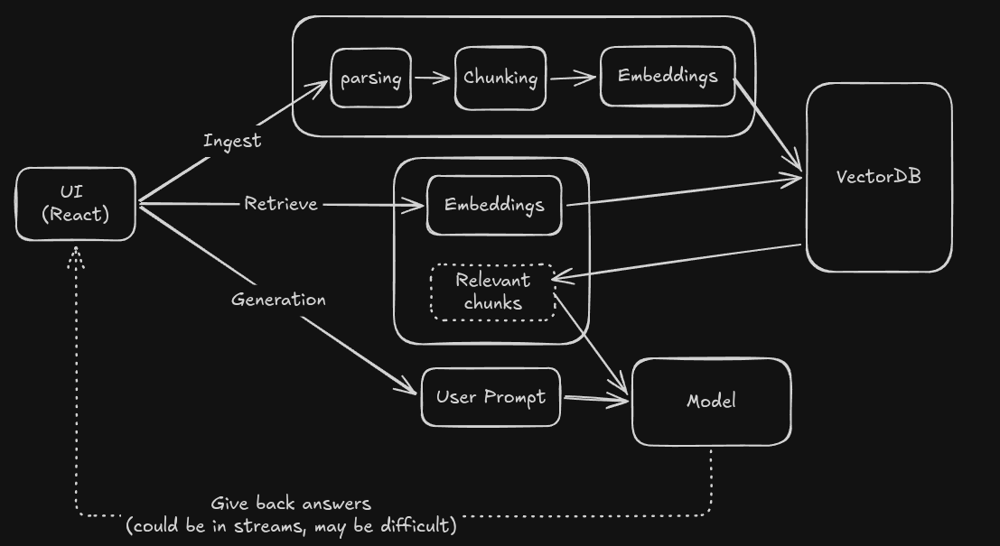

# Scientific Papers Summarizer using with Bullet Points

## Problems and Ideas

During the senior thesis or relating works that requires an intensive amount of research papers reading, sometimes the process would be terribly long, time-consuming, tedious, and prone to errors. In order to partly reduce the burden, we decided to create a project that summarizes the paper into multiple bullet points.

## Authors

- Phan Thai Hoa
- Davian

## How to run

### Dev workflow
```bash
cd src/view
npm run dev
cd ..
uv run fastapi dev # Access through the assigned port
```

### Environment variables

Set these in `.env` at the repo root (gitignored):

- `LLM_API_KEY` — Z.ai API key (required)
- `LLM_MODEL` — model name (default `glm-4.6`)
- `LLM_BASE_URL` — any OpenAI-compatible endpoint (default `https://api.z.ai/api/paas/v4`)

### Production workflow
```bash
cd src/view && npm run build
cd ../.. && .venv/bin/python -m uvicorn src.main:src --port 8000
```

### First run note
PDF parsing is text-first (pymupdf, free and local), escalating to a GLM vision
call only for pages that can't be trusted as plain text (near-empty/scanned or
math-heavy) and for captioning embedded images — so there's no local model
download, but uploads still need `LLM_API_KEY` set and a network connection to
the LLM endpoint. A separate vision-capable model (`LLM_VISION_MODEL`, default
`glm-4v-flash`) handles the vision calls.

### Verifying citations in the app
With a paper uploaded and `LLM_API_KEY` set, ask a question — bullets end in [n]
chips, the Sources list shows sections with cited/uncited state, figure sources
show their image, and math renders via KaTeX.

## High-level Design



## Workflow description

1. Ingest:
    - Send documents to the server side (FastAPI)
    - parse the documents into readable format (JSON or Markdown)
    - Chunk it
    - Create embeddings from those chunks
    - Store it into VectorDB

2. Retrieve and Generate:
    - Convert user questions into embeddings
    - Find similar chunks in VectorDB
    - Return relevant info
    - Combine user prompt and relevant info
    - Feed it into the model
    - Give back the answer

## References:

- Model: GLM via Z.ai's OpenAI-compatible API — https://z.ai/model-list
- Converter: text-first pymupdf extraction with GLM vision (same API) as per-page escalation and per-image captioning — see `src/services/parser.py`'s `parse_file`, `vision_parse_page`, and `caption_figure_image`
- https://martinuke0.github.io/posts/2026-01-06-mastering-rag-pipelines-a-comprehensive-guide-to-retrieval-augmented-generation/#3-generator-augmentation-and-llm